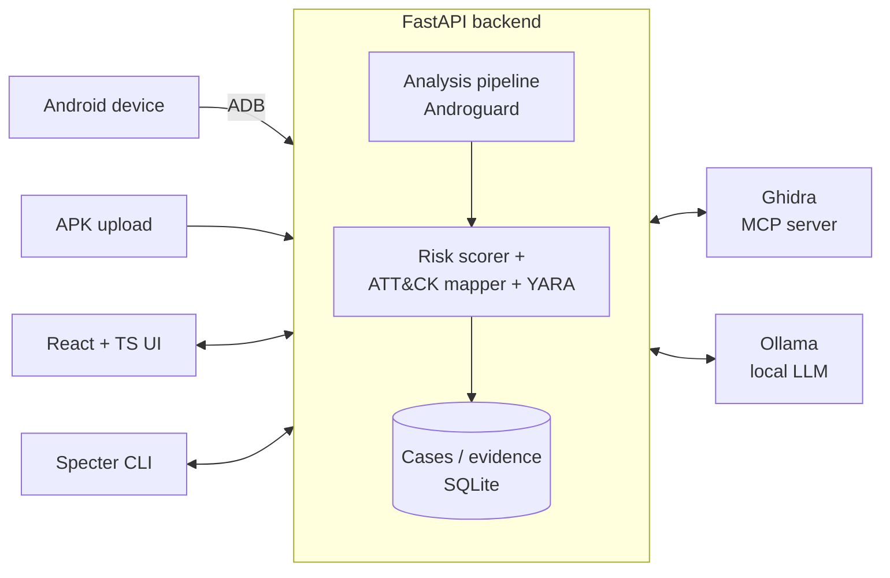

# Sentinel AI

**Forensic analysis platform for malicious Android APKs** — pull an app off a live device or upload it, take it apart statically, score its risk with explainable evidence, map behaviour to MITRE ATT&CK, and work the result as an investigation case.

Built for the fraud-APK problem: fake banking apps, SMS stealers, overlay trojans and similar financial malware distributed outside the Play Store.


-black)

---

## What it does

| Area | Details |
|---|---|
| **Device Lab** | Connect Android devices over ADB, list installed apps, extract APKs (including split APKs), stream logcat, inspect device security state. |
| **Static analysis** | Androguard-based pipeline: manifest, permissions, components, DEX classes, strings, certificates, hashes. Suspicious-function detection over decompiled code. |
| **Risk scoring** | Deterministic, explainable scoring — every point of the score is traced back to a concrete finding, not a black-box label. |
| **Threat mapping** | YARA-style rules for banking trojans, credential theft, overlay attacks and financial malware; findings mapped to MITRE ATT&CK techniques. |
| **Reverse engineering** | Ghidra integration (via an MCP server) for function listing and decompilation of native code. |
| **Local AI analyst** | An LLM running locally through Ollama (`qwen3:4b` by default) summarises findings and explains behaviour — no sample data leaves the machine. |
| **Case management** | Cases with evidence, timeline, entities, notes, triage and generated reports (executive and technical). |
| **Specter CLI** | Terminal client for the same backend — scripting, triage and live monitoring without the UI. |

## Architecture



- **Backend** — `app/`: FastAPI, SQLAlchemy (async SQLite), Pydantic; versioned REST API under `/api/v1`.
- **Frontend** — `frontend/`: React 18, TypeScript, Vite, Tailwind, D3 (graphs), Monaco (code view), Clerk (auth).
- **CLI** — `specter-cli/`: Typer + Rich, talks only to the backend API.

## Getting started

**Prerequisites:** Python 3.11+, Node.js 18+, [ADB platform-tools](https://developer.android.com/tools/releases/platform-tools) (device features), [Ollama](https://ollama.com) (AI features), Ghidra (optional).

```bash
git clone https://github.com/Ontiomacer/sentinal-ai.git
cd sentinal-ai

# Backend
python -m venv venv
venv\Scripts\activate          # Linux/macOS: source venv/bin/activate
pip install -r requirements.txt
cp .env.example .env           # then fill in values
python -m uvicorn app.main:app --reload        # http://localhost:8000/docs

# Local model (optional)
ollama pull qwen3:4b

# Frontend
cd frontend
cp .env.example .env           # VITE_API_URL, VITE_CLERK_PUBLISHABLE_KEY
npm install
npm run dev                    # http://localhost:3000
```

On Windows, `START_BOTH.bat` starts the backend and frontend together.

### Specter CLI

```bash
pip install -r specter-cli/requirements.txt
python specter-cli/cli.py status
python specter-cli/cli.py analyze sample.apk --case CASE-XXXX --ai --watch
python specter-cli/cli.py ghidra decompile CASE-XXXX <function>
python specter-cli/cli.py report generate CASE-XXXX --type executive
```

See [`specter-cli/README.md`](specter-cli/README.md) for all commands.

## Project layout

```
app/
  api/v1/endpoints/   REST routes: upload, cases, evidence, device-lab, app-analysis, ghidra, ai, neural, mcp
  services/           analysis pipeline, risk scorer, ATT&CK mapper, YARA scanner, ADB controller, reports
  models/ schemas/    SQLAlchemy models and Pydantic schemas
frontend/src/pages/   Upload, Scan analysis, Device Lab, Case workspace, Threat operations, AI briefing
specter-cli/          command-line client
ghidra_mcp_server.py  bridge between the backend and Ghidra
```

## Responsible use

Sentinel AI is a defensive tool for analysing malware samples you are authorised to handle. Run unknown APKs only on isolated test devices or emulators.
